# 3D_Prints

Useful 3D print models: OpenSCAD sources, STL exports and slicer projects.

Previews are rendered automatically from every `.stl` and `.3mf` into [`previews/`](previews) (see [`tools/render_previews.py`](tools/render_previews.py)). Print settings below come from the slicer project (`.3mf`) saved in each folder; models without one have none listed.

Jump to: [3D printer](#3d-printer) · [Electronics](#electronics) · [Home, pipes and air](#home-pipes-and-air) · [Outdoors and hobby](#outdoors-and-hobby)

## 3D printer

| Preview | Model | Print settings |
|---|---|---|
| 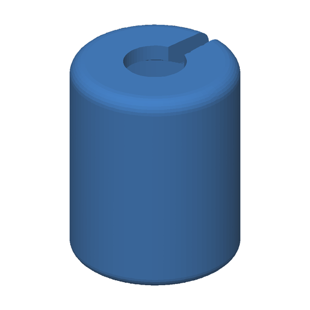 | **[FilamentFilter](FilamentFilter/)** Filament dust filter, from Thingiverse thing 492067. | [FilamentFilter.3mf](FilamentFilter/FilamentFilter.3mf): Artillery Sidewinder X1 (0.4 mm nozzle), PLA, 0.3 mm layers, 10% infill, 3 walls, supports on |
| 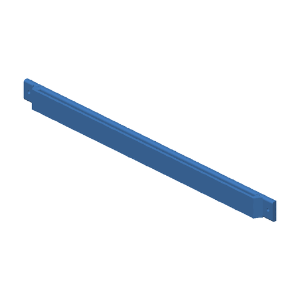 | **[PrinterFilamentHolder](PrinterFilamentHolder/)** Filament holder of my own design, mounted with M3 screws. | [Ye_filament_holder.3mf](PrinterFilamentHolder/Ye_filament_holder.3mf): Sovol SV01 (0.4 mm nozzle), PLA, 0.28 mm layers, 25% infill, 5 walls, supports on |
| 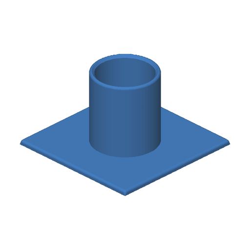 | **[GlueBottleHolder](GlueBottleHolder/)** Stand for a glue bottle: a 90 mm base with a 36 mm holder. | — |
| 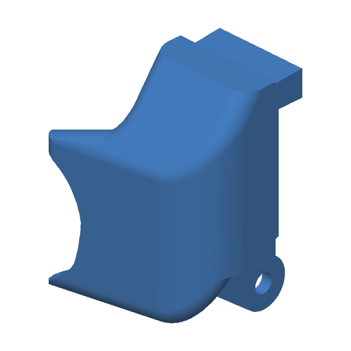 | **[Sovol01FanShroud](Sovol01FanShroud/)** Part-cooling fan shroud for the Sovol SV01, from Thingiverse thing 3984064. This is the one that works well. | [Sv01_fan_1_19_2024.3mf](Sovol01FanShroud/Sv01_fan_1_19_2024.3mf): Sovol SV01 (0.4 mm nozzle), PLA, 0.28 mm layers, 10% infill, 3 walls, supports from build plate only  Tested: `Sv01_fan_less_support_1_19_2024.gcode` prints well with much less support, so it's easier to clean and faster to print. |
|  | **[Sovol+SV01+Part+Cooling+Fan+Duct](Sovol%2BSV01%2BPart%2BCooling%2BFan%2BDuct/)** Earlier Sovol SV01 part-cooling duct by Vapesir (Thingiverse thing 4098868), plus `V5remix.stl`. Its readme recommends Sovol01FanShroud instead. | [SV01_PartCooling_V5+.3mf](Sovol%2BSV01%2BPart%2BCooling%2BFan%2BDuct/files/SV01_PartCooling_V5%2B.3mf): Sovol SV01 (0.4 mm nozzle), PETG, 0.28 mm layers, 10% infill, 3 walls, supports on |
|  | **[level bed](level%20bed/)** Bed-levelling test print (Ender 3 Bed Level by Elproducts, Thingiverse thing 3235018), with ready G-code for the Ender 3 and Sovol SV1. | — |
| 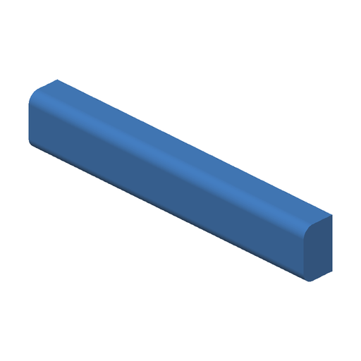 | **[stepmotor_shaft_adaptor](stepmotor_shaft_adaptor/)** 60 mm bar that fits a 5 mm D-cut stepper motor shaft, with a screw tab at each end. | — |

## Electronics

| Preview | Model | Print settings |
|---|---|---|
|  | **[Battery holder](Battery%20holder/)** Holder with side cover for 26650 or 32700 cells, with wiring ducts and room for an over-discharge protection board. Cell count and size are set in `Battery holder.scad`. | [26650 battery holder with cover.3mf](Battery%20holder/26650%20battery%20holder%20with%20cover.3mf): Sovol SV01 (0.4 mm nozzle), PLA, 0.2 mm layers, 20% infill, 3 walls, supports off  [26650 battery holder with cover 8 pairs.3mf](Battery%20holder/26650%20battery%20holder%20with%20cover%208%20pairs.3mf): Sovol SV01 (0.4 mm nozzle), PLA, 0.28 mm layers, 20% infill, 3 walls, supports on |
| 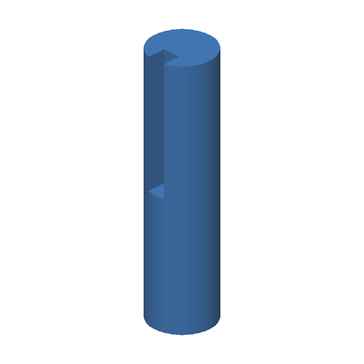 | **[BatteryMock](BatteryMock/)** Dummy AAA (or AA) cell with a wire channel, to power alkaline-battery devices from a LiFePO4 battery. | [AAABatteryMock.3mf](BatteryMock/AAABatteryMock.3mf): Sovol SV01 (0.4 mm nozzle), PLA, 0.28 mm layers, 0% infill, 4 walls, supports on |
| 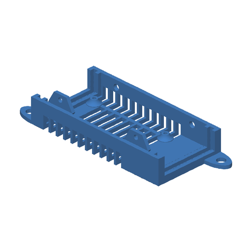 | **[DC_converter_box](DC_converter_box/)** Enclosures (bottom, top, front and back panels) for DC-DC converter boards: XL4015, LM2596, RD green and XL4016 double heat sink. Pick the board in `U_Box_V103_Customized.scad`. | [XL4015_Set.3mf](DC_converter_box/XL4015_Set.3mf): Sovol SV01 (0.4 mm nozzle), PETG, 0.3 mm layers, 10% infill, 3 walls, supports on  [LM2596_Set.3mf](DC_converter_box/LM2596_Set.3mf): Sovol SV01 (0.4 mm nozzle), PLA, 0.28 mm layers, 25% infill, 3 walls, supports on  [RD_Green_Set.3mf](DC_converter_box/RD_Green_Set.3mf): Sovol SV01 (0.4 mm nozzle), PLA, 0.3 mm layers, 20% infill, 3 walls, supports off  [XL4016DoubleHeatSink_Set.3mf](DC_converter_box/XL4016DoubleHeatSink_Set.3mf): Sovol SV01 (0.4 mm nozzle), PLA, 0.3 mm layers, 20% infill, 3 walls, supports off |
| 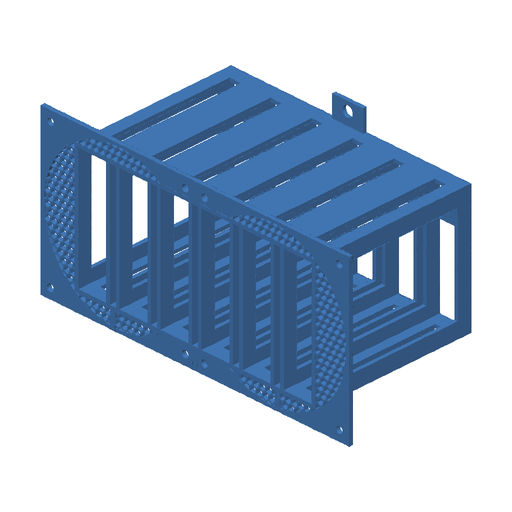 | **[hard_drive_rack](hard_drive_rack/)** Fan-cooled rack for six 2.5" external hard drives with a 120 mm fan and fan guard. | [fan_cooled_hard_drive_rack.3mf](hard_drive_rack/fan_cooled_hard_drive_rack.3mf): Sovol SV01 (0.4 mm nozzle), PLA, 0.28 mm layers, 10% infill, 3 walls, supports on |
|  | **[SnapfitCustomizableRaspberryPi4Case&Stands](SnapfitCustomizableRaspberryPi4Case%26Stands/)** Screwless snap-fit Raspberry Pi 4 case and stands by Malolo (Thingiverse thing 3723561). My picks (compact case, vent slots, camera, display and GPIO slots, 40 mm fan with screw mounts) are in `files/YeZhangPicks`. Use the `Customizer` folder to make other variants. | [RPI4_case_top_and_bottom.3mf](SnapfitCustomizableRaspberryPi4Case%26Stands/files/YeZhangPicks/RPI4_case_top_and_bottom.3mf): Sovol SV01 (0.4 mm nozzle), PLA, 0.28 mm layers, 20% infill, 3 walls, supports on |
| 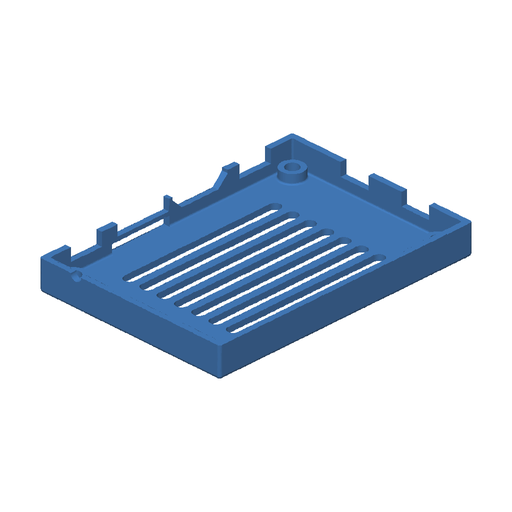 | **[Orange_Pi_Lite_Case](Orange_Pi_Lite_Case/)** Orange Pi Lite case by SpyDrCZ (Thingiverse thing 2035781), with top variants for a fan and an antenna hole. | — |
| 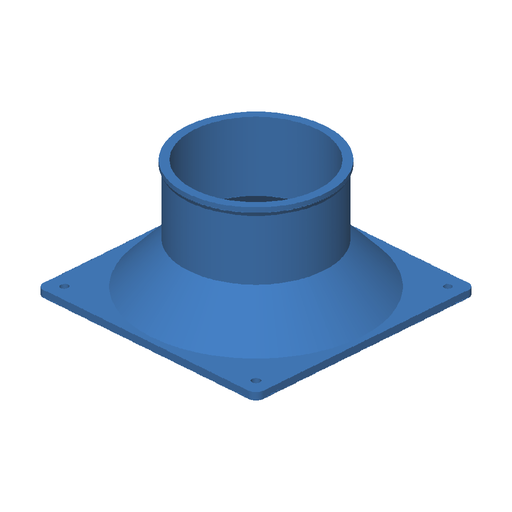 | **[FanAdaptor](FanAdaptor/)** Adapters from a 120 mm or 80 mm fan to a 73 mm duct or a 100 mm foam filter. Based on Thingiverse thing 423186. | — |
|  | **[ImmersiveFanLubricator](ImmersiveFanLubricator/)** Container and cover for soaking a noisy printer fan's bearing in oil without taking the fan apart. | [Container and cover.3mf](ImmersiveFanLubricator/Container%20and%20cover.3mf): Sovol SV01 (0.4 mm nozzle), PLA, 0.28 mm layers, 100% infill, 6 walls, supports on |

## Home, pipes and air

| Preview | Model | Print settings |
|---|---|---|
| 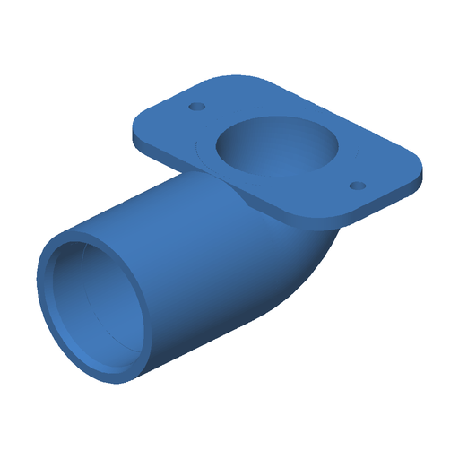 | **[PipeElbow](PipeElbow/)** Customizable 28 mm drain-pipe connectors by Steve Malikoff (public domain): elbows, tees, Y, X, U bend, end cap and straight. My version is `angle_elbow.scad`. The upstream set is in the `28mm+caravan…` folder. | [angle_elbow.3mf](PipeElbow/angle_elbow.3mf): Ender 3 (0.6 mm nozzle), PLA, 0.44 mm layers, 20% infill, 3 walls, supports on |
|  | **[PipePlug](PipePlug/)** Tapered 14 mm pipe plug with a 30 mm flange. Source only, no STL yet. | — |
| 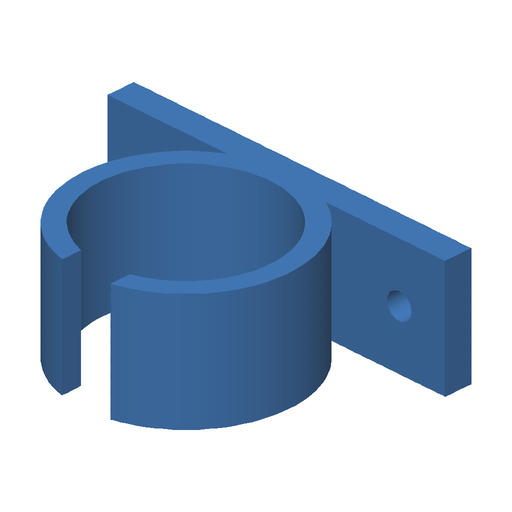 | **[Pipe_Clamp](Pipe_Clamp/)** Clamp for 3/4" SCH40 PVC pipe with a #8 screw hole and room for a wing nut. | — |
|  | **[Different diameters pipes connector](Different%20diameters%20pipes%20connector/)** Reducer joining an 83.5 mm pipe to a 99 mm pipe. Based on Thingiverse thing 423186. | — |
|  | **[Vent pipe holder](Vent%20pipe%20holder/)** Half-pipe holders with a mounting tab for vent pipes: a 3" version and the original. | [3 inch vent pipe holder.3mf](Vent%20pipe%20holder/3%20inch%20vent%20pipe%20holder.3mf): Artillery Sidewinder X1 (0.4 mm nozzle), PLA, 0.3 mm layers, 20% infill, 3 walls, supports on  [vent pipe holder.3mf](Vent%20pipe%20holder/vent%20pipe%20holder.3mf): Sovol SV01 (0.4 mm nozzle), PLA, 0.28 mm layers, 25% infill, 4 walls, supports on  Print standing on the half-circle face, larger contact face down, to keep support to a minimum. |
| 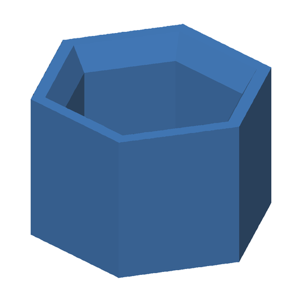 | **[SprinklerValveCap](SprinklerValveCap/)** Hex cap for a sprinkler valve (19 mm across the inner flats). | — |
| 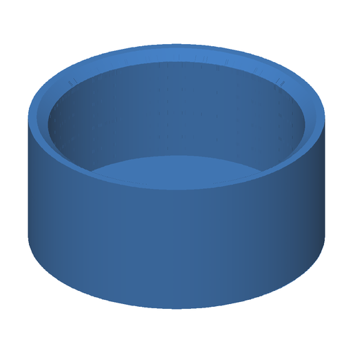 | **[AirCompressorGaugeCover](AirCompressorGaugeCover/)** Protective cap for a 52.8 mm air compressor gauge. | [OrcaSlicerProject.3mf](AirCompressorGaugeCover/OrcaSlicerProject.3mf): Sovol SV01 (0.4 mm nozzle), PLA, 0.2 mm layers, 10% infill, 5 walls, supports off |
| 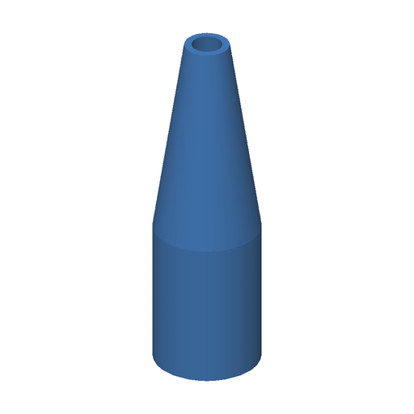 | **[AirHoseAdapter](AirHoseAdapter/)** Adapters from a DeWalt air pump nozzle to a 17 mm air bed port or an 8 mm boat port. | [AirHoseAdapter_pair.3mf](AirHoseAdapter/AirHoseAdapter_pair.3mf): Sovol SV01 (0.4 mm nozzle), PLA, 0.28 mm layers, 10% infill, 3 walls, supports on |
|  | **[FlagHolder](FlagHolder/)** Side-mount flag pole holder by zerog2k (Thingiverse thing 4423615) with 1/2", 5/8" and 3/4" pole clamps (based on Printables model 140149). | [side_mount_flag_pole_holder_v2_and_clamps.3mf](FlagHolder/Side%20Mount%20Flag%20Pole%20Holder%20-%204423615/files/side_mount_flag_pole_holder_v2_and_clamps.3mf): Artillery Sidewinder X1 (0.4 mm nozzle), PETG, 0.3 mm layers, 20% infill, 3 walls, supports off  [Three-size clamps_V2.3mf](FlagHolder/Clamp/Three-size%20clamps_V2.3mf): Sovol SV01 (0.4 mm nozzle), PLA, 0.3 mm layers, 20% infill, 3 walls, supports off |
| 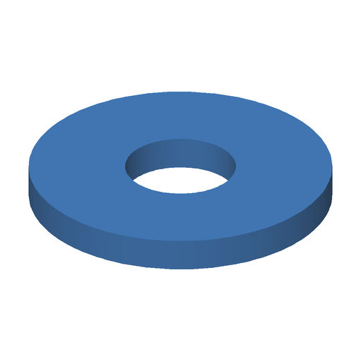 | **[customizable_washer](customizable_washer/)** Flat washer, 11.2 mm outside and 4.1 mm inside diameter. | [Washer.3mf](customizable_washer/Washer.3mf): Sovol SV01 (0.4 mm nozzle), PETG, 0.18 mm layers, 100% infill, 3 walls, supports on |
| 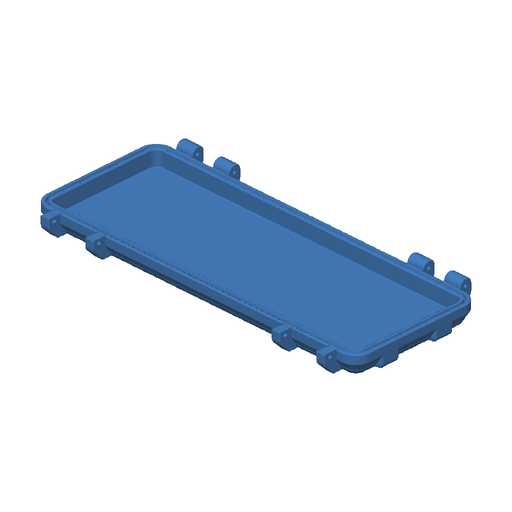 | **[customizable-rugged-box](customizable-rugged-box/)** Parametric rugged storage box by smkent (Printables model 637028), set to 234 × 82 mm inside, with latches. | — |

## Outdoors and hobby

| Preview | Model | Print settings |
|---|---|---|
|  | **[BikeMirrorAdapter](BikeMirrorAdapter/)** Adapter for a bike mirror. Source only, no STL yet. | Print standing on the half-circle face, larger contact face down, to keep support to a minimum. |
| 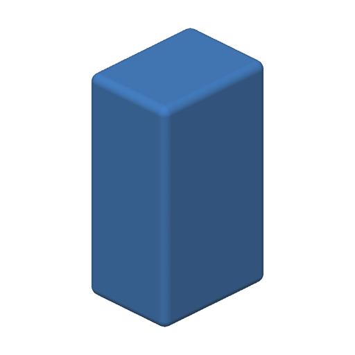 | **[CameraStand](CameraStand/)** Rounded 6 × 8 × 14 cm block to stand a web camera on (`CubeStandForA1.stl` is a second version), plus an L-shaped stand in `CameraStand.scad`. | — |
| 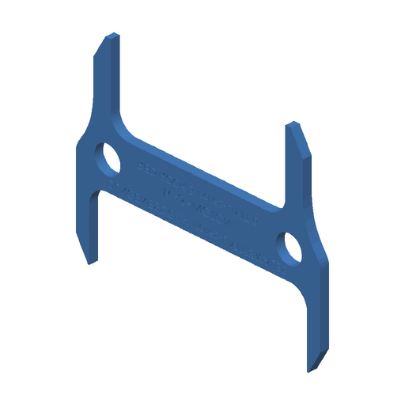 | **[WACrabGauge](WACrabGauge/)** Washington crab gauge, remixed from Thingiverse thing 2839932. | [WACrabGaugeRemix.3mf](WACrabGauge/WACrabGaugeRemix.3mf): Sovol SV01 (0.4 mm nozzle), PLA, 0.28 mm layers, 10% infill, 3 walls, supports on |
|  | **[RC plane prop balancer](RC%20plane%20prop%20balancer/)** Propeller balancer: put it in the prop hub and rest it on a needle. The lower side is the heavy side. | — |

## Libraries

Git submodules used by the OpenSCAD sources (run `git submodule update --init`):

- [BOSL](BOSL), the Belfry OpenSCAD Library
- [MCAD](MCAD), the OpenSCAD parametric CAD library
- [OpenSCAD-common-libraries](OpenSCAD-common-libraries), my shared helpers

## License

[MIT](LICENSE) for my own designs. Remixed and downloaded designs keep their original licenses; see the LICENSE or README file in their folders.
